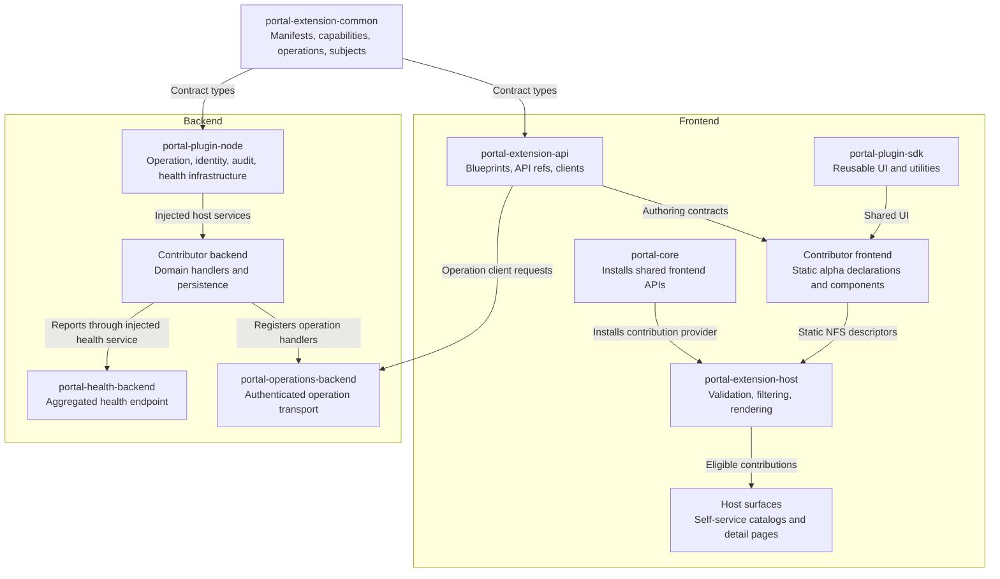
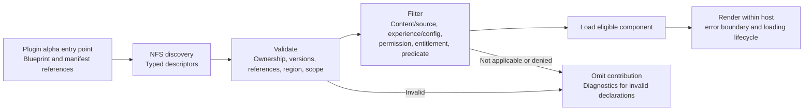
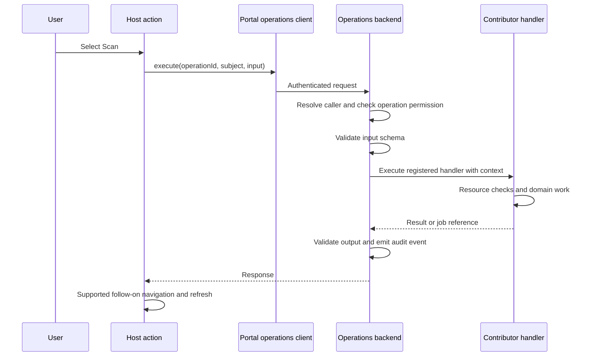
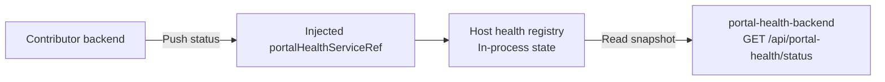

# Portal SDK architecture

The Portal SDK lets independently installed plugins contribute functionality to
host-owned surfaces. Plugins declare capabilities and typed native frontend
extensions; the host validates, filters, and renders them. Backend operations
are registered separately so multiple UI surfaces can reuse the same handler.

This page describes the current implementation on the plugin-factory SDK branch. It is an experimental implementation, not a supported release
or a claim that the complete Content Experience Architecture has shipped.

## Host, experience, and contributor

- **Host:** owns the supported interaction contracts, semantic attachment
  regions, context, validation, and presentation lifecycle.
- **Experience:** a host-owned user goal such as Content Quality, Authoring,
  or Migration. A plugin is not an experience.
- **Contributor:** supplies domain components, predicates, operation handlers,
  and plugin-owned persistence. APME is the current third-party example.
- **Capability:** a plugin's functionality, with one or more entry points such
  as a summary card, detail tab, or scan action.

Self-service currently supplies the catalog and detail pages. It consumes host
adapters without importing APME's implementation. Content browsing still awaits
the planned content ownership split.

## Package and runtime relationships

Arrows indicate contract consumption or runtime communication, as labeled.
This is not an exhaustive package dependency graph or plugin load order.

`portal-core` installs `api:portal/contributions` and the operation and
entitlement API factories. Its navigation module selects discovered pages using
configuration. It is not a Module Federation singleton registry provider.

The frontend and backend SDK packages are libraries, not standalone page
plugins. Contributor backends inject shared host services instead of creating
independent operation or health registries.

## Native contribution lifecycle

Entity/catalog descriptors reach the shared provider through stable NFS data
reference IDs. Pages read its validated snapshot via
`portalContributionsApiRef`. Scaffolder fields have a separate native input on
the templates page; not every Blueprint uses the entity/catalog provider input.

Static declarations load with the plugin. Component loaders remain deferred
until eligibility checks pass; a tab component loads when that eligible tab is
selected. Runtime predicates narrow the declared scope and cannot broaden it.

There is no native module-load registration into a global mutable
`ContributionRegistry`. The explicit legacy app retains separate compatibility
helpers; do not install both registration paths in the native app.

## Operation execution

The client discovers the `portal-operations` backend and sends an operation ID,
the current subject's entity reference, and optional input. The manifest does
not supply a handler URL. A descriptor alone does not install a handler: the
backend registers it through `portalOperationsServiceRef`.

The dispatcher checks operation permission and input/output schemas when
declared. The handler remains responsible for resource access and domain checks.
An accepted scan request is not a completed scan; job progress and findings
belong to the contributor.

> **Important:** Backend organization consistency and entitlement enforcement
> remain hardening work. The current REST operation router derives organization
> from the authenticated user's catalog namespace, while entitlement decisions
> use a server-configured active-organization resolver. Frontend entitlement
> filtering is not complete server-side authorization.

## Backend health reporting

Health reporting is independent of contribution rendering. The endpoint
aggregates plugin status; it is not a durable history store or a domain job
tracker. A frontend health component exists in the host library, but the current
deployment intentionally does not install a health dashboard or indicator.

## Ownership and compatibility boundaries

- RHDH loads exported plugin packages; Portal contracts define what their
  contributions mean. Platform adapters own discovery and authenticated fetch.
- Plugins select supported semantic attachments, not CSS selectors or arbitrary
  runtime module URLs. Host pages own the layout.
- Operations are separate from presentation. New server effects must use
  registered operations; remaining legacy mutation paths still need migration.
- Common metadata must remain serializable. New native predicates belong on
  executable frontend descriptors, even though legacy contract fields remain.
- The current manifest requires `experienceId`. The proposed advisory
  recommendation and richer host composition preview/activation/rollback model
  are not implemented by the generic attachments alone.

## Delivered scope and remaining work

The implementation has native tabs, overview cards, entity/catalog actions, catalog tabs
and columns, scaffolder workflow launchers, and native scaffolder fields. APME
demonstrates Quality, activity, dependencies, scan actions, repository
registration/removal, and background-result refresh.

Do not infer universal launch support from the common launch union. Native
entity actions support operations and constrained entity-tab follow-ons;
catalog-header workflows use registered scaffolder template descriptors.
Other combinations require a supported host adapter.

Remaining work includes content extraction and agreed query/write
contracts, consistent backend tenant and entitlement enforcement, remaining
operation guarantees, configuration/default-off conformance, published preview
artifacts, and repeatable release acceptance. Audit emission currently means
structured events, not a durable audit database; `idempotent` metadata does not
provide a persisted idempotency-key mechanism.

Packed dynamic exports were exercised on `next-2.1` with mock AAP authentication.
Real AAP login and completed scan-only work were verified separately in the
source NFS app. These are bounded acceptance checks, not broad platform or
remediation compatibility guarantees.

## Related documentation

- [Third-party plugin author guide](portal-sdk-plugin-author-guide.md)
- [Native NFS composition](portal-sdk-nfs-composition.md)
- [Implementation scope and remaining architecture](portal-plugin-factory-implementation-guide.md)
- [Backend SDK](../plugins/portal-plugin-node.md)
- [Operations backend](../plugins/portal-operations-backend.md)
- [Health backend](../plugins/portal-health-backend.md)
